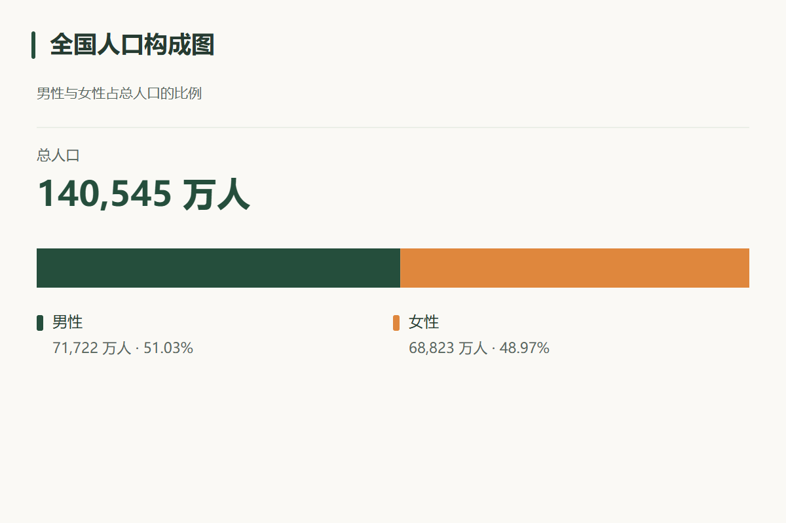
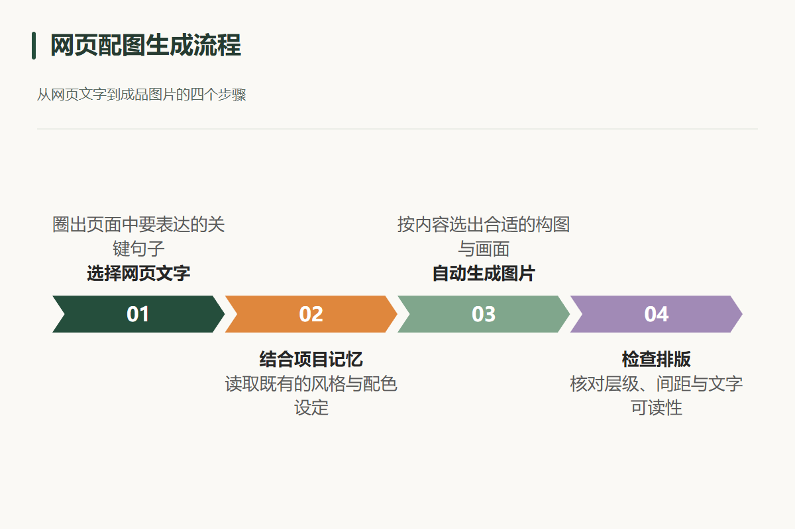
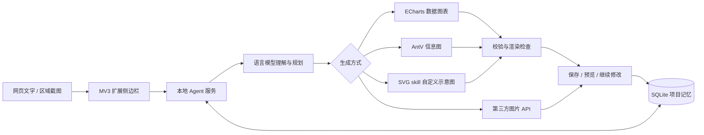

# Frame Agent · 浏览器视觉创作助手

**选一段内容，让 Agent 理解、绘图，并记住你的项目。**

Frame Agent 是一个带项目记忆的 Chrome / Edge 扩展。它把网页文字和局部截图转为可编辑的图表、信息图或模型生成的图片，支持右键生图、AI 解释与连续追问，让内容采集和创作在浏览器侧边栏内完成。

## 效果预览

以下为实际生成结果，人口数据来自测试输入，不代表数据来源声明。

| 数据图表 | 流程信息图 |
| --- | --- |
|  |  |

## 项目亮点

- **Agent 自动选路**：规则与模型共同判断，统计图交给 ECharts，信息图使用 AntV，自定义示意图使用 SVG skill，写实画面调用独立图片 API。
- **项目级记忆**：SQLite 保存项目设定、素材和历史任务；编辑时携带原图与结构化数据，支持“沿用上次配色”“只改标题”等连续创作。
- **可编辑风格记忆**：直接保存风格、配色、角色特征、文字风格和排除项，支持清空、撤销上次保存和窗口间冲突检查。
- **图片提示词 skill**：图片路线自动整理主体、构图、光照、准确文字和参考图用途，校验后生成最终提示词；本次要求优先于旧记忆。
- **受约束的 SVG 生成**：数据证据与合计校验、浏览器渲染、文字越界和重叠检测；自由绘图加入视觉复核，最多修复两次。
- **浏览器原生入口**：右键直接生图、加入可编辑草稿、AI 解释；支持区域截图和 SVG / PNG 导出。
- **可配置模型**：语言模型和图片服务分别配置，支持 DeepSeek 与 OpenAI 兼容接口。图片模型名可填写中转站提供的 `gpt-image-2`；兼容性取决于中转站实际接口。
- **可靠任务处理**：有界队列、幂等请求、项目隔离、配置快照和中断恢复，避免网络重试重复提交。

## 架构



技术栈：TypeScript · React · Manifest V3 · Node.js 24 · SQLite · ECharts · AntV Infographic · Playwright。

## 使用流程

这是 **Chrome / Edge Manifest V3 浏览器插件**。主要入口是：

**选中文字 → 右键「Frame · 直接生图」→ Agent 自动选择 SVG 或图片 API → 侧边栏展示结果。**

0.5.0 侧边栏提供 **生图 / AI 解释** 两个入口：

- **直接生图**：立即提交选中文字。
- **将选中文字加入 Frame**：直接填入生图输入框，可修改原文、补充要求后点“生成”；不再确认导入。再次采集会追加内容，不覆盖已有草稿。首次使用自动创建默认项目，草稿按项目保存在插件本地，关闭后可恢复。
- **AI 解释**：立即把原文交给语言模型，自动显示解释。可以继续追问，Enter 发送、Shift+Enter 换行。原文和解释记录在当前项目内保存，失败可重试。

输入区默认展开，项目记忆与素材收纳在折叠区；生成方式由 Agent 判断，编辑/融合选项放在“更多选项”中。

不用打开独立工作台网页，也不需要先把文字加入素材再点一次生成。插件沿用当前项目；首次右键生图会自动创建默认项目。截图、手动文字、参考图和项目设定仍可在侧边栏管理。

## 安装和启动

从本仓库下载源码并解压，或克隆后进入项目。GitHub Releases 提供已构建的插件压缩包；解压后可直接加载。插件仍需以下本地 Agent 服务。

**Windows：安装 Node.js 24+ 后，双击「启动 Frame.cmd」。** 首次缺少依赖时自动安装，缺少插件构建时自动构建；服务就绪后可关闭启动窗口。再次双击会复用已运行的服务。它不会自动随 Windows 开机启动；重启电脑后再次双击即可。

完整启动包 `frame-starter-0.6.0.zip` 包含服务、插件与启动入口；`frame-extension-0.6.0.zip` 仅包含插件。完整包不包含 Node.js、模型密钥或用户数据，首次准备依赖需要联网。

需要 Node.js 24+ 和本机 Edge / Chrome（用于无界面排版检查）。可用 `FRAME_BROWSER_PATH` 指定浏览器；未找到本机浏览器时需要先运行 `npx playwright install chromium`。本地 Agent 服务负责模型密钥、工具调用和 SQLite 记忆；用户交互在插件里完成。

```powershell
cd frame-agent
npm ci
npm run build
npm run server
```

1. 打开 Chrome 的 `chrome://extensions` 或 Edge 的 `edge://extensions`。
2. 开启开发者模式，选择“加载已解压的扩展程序”。
3. 选择项目中的 `dist` 文件夹。
4. 在普通网页选中一段文字，右键选择 **Frame · 直接生图**。
5. 在自动打开的侧边栏查看结果、路由理由、提示词、历史版本和项目记忆。

已经安装旧版时，先运行构建，然后在扩展管理页点击 Frame 的“重新加载”，并关闭再打开侧边栏。后端代码改动后也需要重启 `npm run server`。

启动失败时先看窗口提示。端口被占用不会结束其他程序；旧服务需要先关闭。后台服务日志位于 `.data/service.log`。开发者仍可使用上述命令以前台方式运行服务。

`127.0.0.1:8787` 现在只提供本地 API 和服务说明，不提供独立工作台。不要把这个地址当作插件入口。

## 两种生成方式

### 项目风格与图片提示词

侧边栏顶部「项目记忆」可以编辑用途、视觉风格、配色和长期约束；展开「角色、文字与排除项」可补充人物/产品特征、文字排版偏好和避免内容。保存后参与后续创作，本次明确要求优先。清空风格需要再点保存才生效；撤销上次保存立即恢复上一版，最多保留 10 次变化。已有任务保留提交时的记忆快照。

图片路线会加载新的 [image-prompt skill](agent-skills/image-prompt/SKILL.md)，正常增加一次语言模型调用，结构异常最多修复一次。最终提示词会记录在「创作依据」中，再原样交给已有图片 API。SVG 流程不增加这一步。参考方法及验证边界见 [调研记录](docs/image-prompt-research.md)。

| 输入与用途                               | Agent 选择     | 实际执行                               |
| ---------------------------------------- | -------------- | -------------------------------------- |
| 统计图表 | SVG | 模型提取数据，ECharts 计算几何并输出 SVG |
| 流程、时间线、信息卡片 | SVG | 模型提取内容，AntV Infographic 模板排版 |
| 架构、分支关系等自定义示意图 | SVG | SVG skill 自由绘制，渲染后视觉检查 |
| 人物肖像、风景、摄影、写实场景           | 图片 API       | 语言模型编写提示词，调用独立图片服务   |
| 混合或不明确的内容                       | 由规划模型判断 | 根据核心用途决定，记录选择理由         |
| 基于已有图片继续修改                     | 默认延续原格式 | SVG 带上原始代码；图片 API 带上原图    |

明确的结构/场景规则约束模型选路；不明确时由模型返回结构化决策。用户不需要手动选择生成引擎。当前明确要求优先于历史风格。不会因为图片 API 缺少配置就悄悄改成 SVG，或在 SVG 失败时自动调用另一个付费模型。

### SVG skill

运行时首先加载 [structured.md](agent-skills/svg-drawing/structured.md)，生成受约束的内容描述，再选择渲染器。统计图使用 ECharts SSR，模型不再编写柱长、圆弧和坐标。流程和信息图使用 AntV 模板，中文经过浏览器实际测量后转为原生 SVG 文本。自定义示意图才加载 [SKILL.md](agent-skills/svg-drawing/SKILL.md) 自由绘制。

- 数值需要对应原文证据；完整构成图校验分项与总量、百分比合计。比例由引擎计算。
- 项目记忆保存原图的结构化描述，后续修改带上原始数值和类别。
- 每张 SVG 都通过元素白名单、实际渲染、文字边界、文字重叠和最小字号检查。浏览器渲染禁止外部网络资源。
- 自由绘图额外把预览交给支持视觉输入的语言模型检查。校验失败最多修正两次；不会改走付费图片 API 绕过失败。
- 图表目前支持单系列、统一单位、2–8 项；信息图文本过长会要求模型压缩措辞，校验仍失败时明确报错，不静默删除数据。

结果支持 SVG 下载和 PNG 导出。固定字体优先 Microsoft YaHei，其他系统建议安装 Noto Sans CJK SC。下载的 SVG 保留可编辑文字；查看设备缺少字体时外观可能有所差异。检查可以发现常见布局问题，但不能保证语义、图片读数或所有遮挡都正确。

运行 `node scripts/svg-gallery.mjs` 可生成七类图形的横竖版样例。实现参考 [ECharts 服务端渲染](https://echarts.apache.org/handbook/en/how-to/cross-platform/server/) 与 [AntV Infographic](https://github.com/antvis/Infographic)。

## 模型配置

点击插件侧边栏右上角齿轮 **“模型设置”**，或在浏览器扩展管理页打开 Frame 的“扩展程序选项”。设置页属于插件，配置两种模型时无需编辑文件。

设置页支持：

- 分别填写语言模型和图片模型的接口地址、API 密钥与模型名称。
- 选择 Responses / Chat Completions 协议、图片返回格式、参考图编辑能力和图片下载域名。
- 在演示模式和真实模型之间切换。
- 点击“检查连接”读取服务的模型列表，并从列表选择模型。检查使用 `GET /models`，不会发送素材、生成图片或验证实际推理能力；服务不提供该接口时会明确提示，仍可保存配置。
- 保存后立即用于新任务，不需要重启。已运行和已排队任务继续使用提交时的配置。

密钥保存在本机 SQLite 数据库，读取接口只返回“是否已保存”，不返回密钥原文；密钥不会写入插件存储或安装包。密钥输入框留空会保留已有密钥；可明确清除。修改服务域名后，原密钥不会自动带到新服务。多个设置窗口同时编辑时，旧版本会被拒绝，避免覆盖更新。

首次读取使用 `.env` 作为默认值；在设置页保存后，以数据库中的配置为准。修改 `.env` 不会覆盖已保存的设置。

默认 `PROVIDER=demo`，不调用付费模型。SVG 路线展示根据输入拼出的简单示例；图片 API 路线展示带标识的 PNG 占位图。**演示输出不是语言模型或生图模型的真实效果。**

需要用环境变量初始化时，可参考 `.env.example` 编辑 `.env`：

```dotenv
PROVIDER=live

LLM_API_KEY=语言模型密钥
LLM_BASE_URL=https://api.openai.com/v1
LLM_MODEL=gpt-4.1-mini
LLM_API_STYLE=responses

IMAGE_API_KEY=图片服务密钥
IMAGE_API_BASE_URL=https://你的图片服务/v1
IMAGE_API_MODEL=服务支持的图片模型名
IMAGE_API_SUPPORTS_EDIT=true
IMAGE_API_RESPONSE_FORMAT=auto
IMAGE_DOWNLOAD_HOSTS=
```

- 语言模型与图片服务可以来自不同供应商，分别使用自己的地址和密钥。
- 语言模型支持 Responses 或 OpenAI 兼容 Chat Completions；后者设置 `LLM_API_STYLE=chat`。一般接口需要支持结构化 JSON Schema 输出；DeepSeek 官方接口自动使用 JSON Output，并在本地校验方案字段。涉及截图时还需支持视觉输入。
- SVG 路线不要求图片 API 密钥；自由绘图的视觉检查和截图理解需要所选语言模型支持图片输入。纯文本统计图和模板信息图无需视觉输入。
- 图片服务当前适配 **OpenAI 兼容 Images 协议**：`/images/generations` 和可选的 multipart `/images/edits`。这不等于支持所有供应商的私有接口；私有协议需要扩展 `server/image-api.mjs`。
- 图片结果支持 `data[0].b64_json` 或 `data[0].url`。返回 URL 时，填写 `IMAGE_DOWNLOAD_HOSTS` 为实际图片 CDN 的 HTTPS 域名，多个域名用逗号分隔。下载不会携带 API 密钥，也不跟随跳转。
- 默认不传 `response_format`；供应商要求时可设置 `b64_json` 或 `url`。不支持参考图编辑的服务设置 `IMAGE_API_SUPPORTS_EDIT=false`，带图任务会明确提示能力不足。
- `.env`、数据库不会打包进插件。旧版 `OPENAI_API_KEY`、`OPENAI_BASE_URL`、`PLANNER_MODEL`、`IMAGE_MODEL` 仍兼容；设置独立图片地址后需要独立图片密钥，不会把语言模型密钥发给第三方。
- 图片尺寸默认按 1:1 / 3:2 / 2:3 映射为 1024×1024 / 1536×1024 / 1024×1536。选择支持这些尺寸的服务，其他尺寸协议需修改适配器。

接口实现核对了 [Structured Outputs 官方文档](https://developers.openai.com/api/docs/guides/structured-outputs)、[图片编辑接口文档](https://developers.openai.com/api/reference/resources/images/methods/edit) 和 [模型列表接口](https://developers.openai.com/api/reference/resources/models/methods/list)。模拟测试验证调用格式和分流；不同服务的实际权限、额度和图片生成能力需要分别验证。

### 接入 DeepSeek

在“模型设置”中选择真实模型模式，语言模型地址填 `https://api.deepseek.com`，协议选 **Chat Completions**，填写自己的密钥。点击“检查连接”后从返回列表选择模型；当前可使用 `deepseek-flash`。

官方 DeepSeek 地址自动采用 `json_object` 规划输出，并把字段约束和示例交给模型；结构化绘图同样使用 JSON，原始 SVG 仅用于自由绘图，并经过渲染与视觉检查。为控制交互等待与输出量，使用非思考模式，规划最多 4096 token，绘图最多 8192 token；截断输出会明确报错。

DeepSeek 负责需求理解、提示词和 SVG 绘制。人物、风景等图片仍需要在“图片模型”中配置独立的生图服务；语言模型密钥不会自动用于该服务。截图输入取决于所选模型的视觉能力。

2026-10-26 已实测 `deepseek-flash`：模型列表、选中文字直出接口、规划、SVG skill 绘图、结果保存与 PNG 渲染通过。样例保存在“DeepSeek 接入验证”项目。这次实测未覆盖截图理解或第三方图片生成。

参考 [DeepSeek 接入说明](https://api-docs.deepseek.com/)、[JSON Output](https://api-docs.deepseek.com/guides/json_mode/) 和 [视觉输入](https://api-docs.deepseek.com/guides/vision/)。

## 项目记忆与连续创作

- 在侧边栏选择当前项目，右键生图自动使用该项目。项目、素材和任务分别隔离。
- 长期设定保存用途、画风、配色、比例和约束；素材可以固定为长期参考。
- 本次检索顺序：修改原图 → 手动选择 → 长期参考 → 相关历史，最多 6 份素材。
- 最近三次成功创作的要求与摘要帮助理解“沿用上次”。延续表达还会尝试引用最近生成图。
- 检索目前采用中文字/双字词与英文词重叠，加上规则判断；不是向量语义检索。
- 每个任务冻结当时的设定、历史上下文与引用来源，后续修改不会改写旧记录。
- “以此继续”打开补充要求区，可以修改原图。临时要求不会自动污染长期设定。
- 右键请求持久化唯一标识，网络失败后点击“重试上次右键任务”不会重复创建同一任务；用户再次右键则视为新请求。

## 截图与文字素材

右键“将选中文字加入 Frame”只填入本地可编辑草稿，点击“生成”后才发送给模型；右键“Frame · 直接生图”和“Frame · AI 解释”会立即发送选中文字。框选截图保留为独立采集方式，按 Esc 取消。

截图在插件内按实际像素比例裁剪，只保存选区。普通网页支持内容注入，浏览器设置页和扩展商店等受保护页面不支持。更换标签页后若出现权限不足，点击 Frame 工具栏图标或从网页右键菜单重新操作。

生成时，实际引用的文字与图片会发送到配置的模型服务；仅收集到本地素材库不会调用模型。

## AI 解释与追问

解释沿用模型设置中的语言模型，不调用生图 API。每次追问携带原文以及本次对话最近 12 次成功问答，回答保存在本地 SQLite；与生图历史分开，不会把解释自动变成绘图素材。原文与历史内容作为数据传入模型，界面按文字渲染，不执行网页片段或模型返回的 HTML。

解释与生图共用有界任务队列。右键提交和追问使用唯一请求标识，网络重试不会重复调用；同一对话等待回复期间不能提交新问题。每次调用固定提交时的模型配置；服务重启会把未完成回复标记为可重试失败。单次原文最多 12000 字、追问最多 4000 字，每个对话最多 100 次提问。

2026-10-27 已通过 DeepSeek 实测原文解释与连续追问，并在隔离浏览器的真实扩展页面中验证读取和显示；样例保存在“DeepSeek 接入验证”项目的解释记录中。

## 结构

```text
public/background.js          右键直出、当前项目、请求重试、截图采集
public/capture.js             框选遮罩与 Esc 取消
src/                         插件侧边栏、预览、导出、项目记忆
src/SettingsPage.tsx          插件模型设置页面
src/ChatPanel.tsx             原文解释、连续追问、历史恢复
server/chat.mjs              解释任务、对话隔离与幂等提交
server/settings.mjs          配置校验、密钥保留/清除、连接检查、即时生效
server/routing.mjs           规则约束与模型路由决策
server/providers.mjs         语言模型规划、SVG skill 调用与有限修复
server/svg.mjs               SVG 校验、PNG 栅格化、演示 SVG
server/image-api.mjs         独立第三方图片接口适配
server/image-prompt.mjs      结构化绘图说明、校验与提示词编译
server/app.mjs               API、任务队列、右键幂等提交
server/store.mjs             SQLite 项目、素材、任务持久化
agent-skills/svg-drawing/    实际参与推理的 SVG 技能
agent-skills/image-prompt/   实际参与推理的图片提示词技能
scripts/launch.mjs           Windows 双击入口使用的服务启动器
```

本地服务仅监听 127.0.0.1，固定插件默认端口 8787，不含多用户登录，不应直接暴露公网。数据保存到 `.data/frame.sqlite`，备份时关闭服务并复制整个 `.data`。重启时未完成任务会标记为中断。

## 验证与开发

本地构建与自动化测试可通过 `npm run check` 检查。GitHub Actions 配置保存在 [`docs/github-actions-ci.yml`](docs/github-actions-ci.yml) 作为示例；当前发布未启用云端自动测试。需要时将此文件复制到 `.github/workflows/ci.yml`，并使用具备 workflow 权限的账号或令牌提交。

```powershell
npm run check
# 以下测试独占 8787，先停止普通后端；使用内存数据库和独立浏览器配置。
npm run test:ui
npm run test:extension
npm run test:settings
npm run test:workspace
# 插件开发：持续构建，随后在浏览器扩展管理页重新加载。
npm run dev:extension
```

- 逻辑测试覆盖项目隔离、右键幂等、结构图与风景选路、SVG skill 实际进入模型请求、SVG 修复次数、恶意 SVG 拒绝、第三方密钥隔离与图片下载、原图传递、持久化和失败状态。
- 模型设置测试覆盖重启持久化、密钥不回传、切换域名不沿用原密钥、版本冲突、无生图的连接检查，以及排队任务保持原配置。设置页集成测试覆盖原生扩展选项入口、模型列表选择、保存立即生效、关闭后重新读取、密钥清除和窄屏布局。
- 解释测试覆盖原文与历史传递、重复提交、并发限制、失败重试、项目隔离和重启恢复。工作区集成测试覆盖文字直接进入草稿、追加编辑、刷新恢复、提交生成，以及右键解释、追问、重试和窄屏布局。
- 插件测试实际加载 MV3，覆盖文字采集、框选裁剪、右键处理函数直出、自动创建项目、SVG 结果、PNG 导出、继续修改、图片 API 路线、项目切换与刷新恢复。
- 无头浏览器无法点击原生右键菜单和工具栏：集成测试调用同一个生产菜单处理函数，并替代打开侧边栏的用户手势。截图 API 使用真实浏览器截图作为输入。**原生菜单点击、侧边栏开合和 activeTab 授权仍需手动验收。**
- UI 测试的网页渲染仅是测试夹具，生产服务不会开放它。截图输出在 `test-results/`。
- 默认使用 Windows Edge。其他环境安装 Playwright Chromium，或设置 `EXTENSION_BROWSER_PATH`；不会操作日常浏览器用户配置。

当前边界：自由 SVG 的视觉复核不是统一质量评分；没有自动 OCR、向量库、私有图片协议适配、批量生图或云端同步。真实图片的角色一致性取决于模型；当前系统保证记忆和参考被正确传递。

### 0.5.0 验证记录（2026-10-27）

构建与自动化测试覆盖数据来源、总量一致性、结构化记忆、重试边界、实际浏览器的七种图形横竖版渲染，以及自由绘图视觉检查反馈。插件工作区回归覆盖选中内容进入编辑框、追加、生成、AI 解释与追问。

使用已配置的 DeepSeek 实测：总人口 140545 万人，男性 71722 万人、女性 68823 万人的构成图；仅修改蓝色并保留所有数量；另起四步骤流程图。三次首次校验通过，结果存于“SVG 0.5 改造验证”项目。此记录不代表已实测第三方生图 API 或自由绘图视觉能力。
