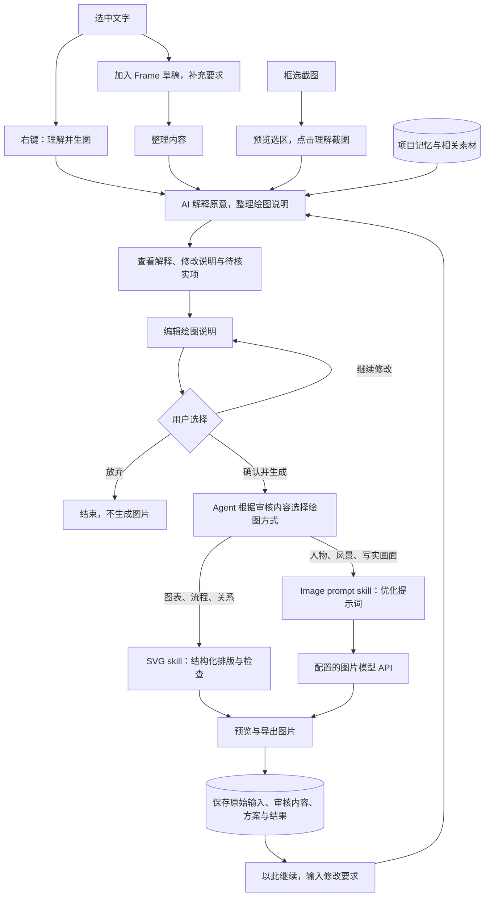
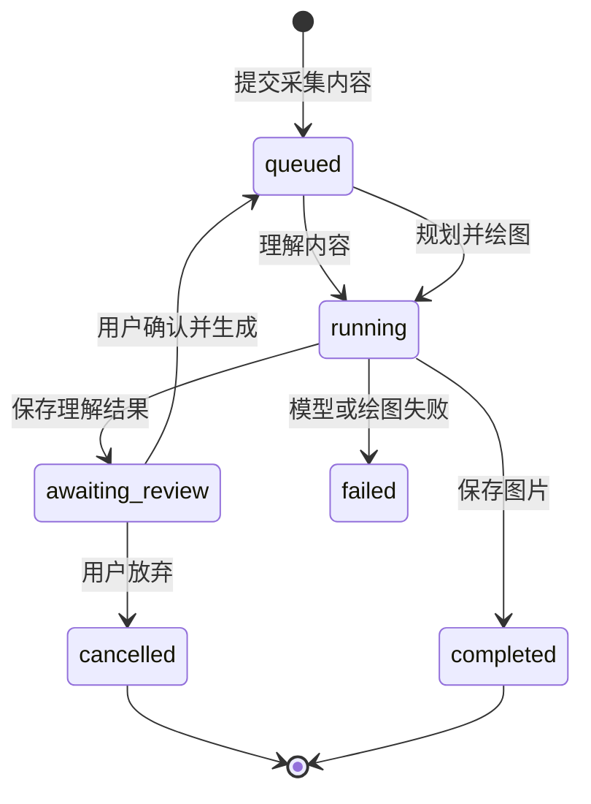

# 从网页内容到图片

Frame 的主流程是：**采集 → AI 理解与整理 → 用户审核 → Agent 绘图 → 保存与继续修改**。

## 用户流程

1. **采集**：文字可从右键直接进入理解，也可以先进入可编辑草稿。截图先裁剪，再预览选区并点击「理解截图」；不会把整页截图作为选区提交。
2. **理解**：语言模型解释内容含义，判断是否需要改写，把抽象论述、长段落或截图组织成适合表达的主体、节点、关系与短标签。删减和视觉类比需要说明，不编造数据或把相关性改成因果。
3. **审核**：用户查看原文/截图、AI 的解释、整理了什么以及待核实项，直接编辑绘图说明。点击「确认并生成」才允许绘图；「放弃」结束任务。明确的绘画要求也经过审核，AI 应尽量保留它们。
4. **生成**：审核内容是当前最高优先级要求。Agent 自动选路；SVG 使用图表/信息图工具或自由绘图 skill，图片 API 路线通过 image-prompt skill 优化提示词。渲染器和最终提示词在结果的「创作依据」中可查。
5. **保存与延续**：保留原始输入、AI 整理结果、用户实际批准的说明、项目记忆快照和图片。后续修改重新经过理解和审核；临时要求不会自动覆盖项目长期风格。

## 界面与任务状态

侧边栏顶部显示四步进度：「采集内容 → AI 理解 → 用户审核 → 生成图片」。审核卡片提供解释、改写说明、待核实项、原始内容和可编辑的绘图说明。刷新页面后保留待审核任务与本地编辑草稿。

第一次执行只理解内容，确认后的执行才规划和绘图；`request.approvedAt` 区分两个阶段。待审核状态保存在 SQLite，不占用绘图队列，服务重启不会自动生成。审核请求带版本号；同一版本和内容重复提交返回同一任务，修改已批准内容会被拒绝。失败任务可从原内容重新整理和审核。

项目记忆与引用素材在提交理解时形成快照。语言模型配置分别在理解、确认生成时固定，因此用户可以在等待审核时调整模型，已经开始执行的阶段则不会随设置变化而切换模型。

## 截图与验证边界

截图会作为真实图片输入交给语言模型，需要配置支持图片理解的语言模型。只支持文本的接口可能拒绝截图，界面会提示改用文字或更换模型；不会假装完成 OCR。演示模式展示流程，但不声称理解了截图。

图片质量和事实忠实度仍需要用户核实。用户审核的是绘图说明，最终提示词会由 Agent 在此基础上组织，系统并不承诺模型完全不会偏离。图片 API 中转站兼容性不在此版本新增的验证范围内。
